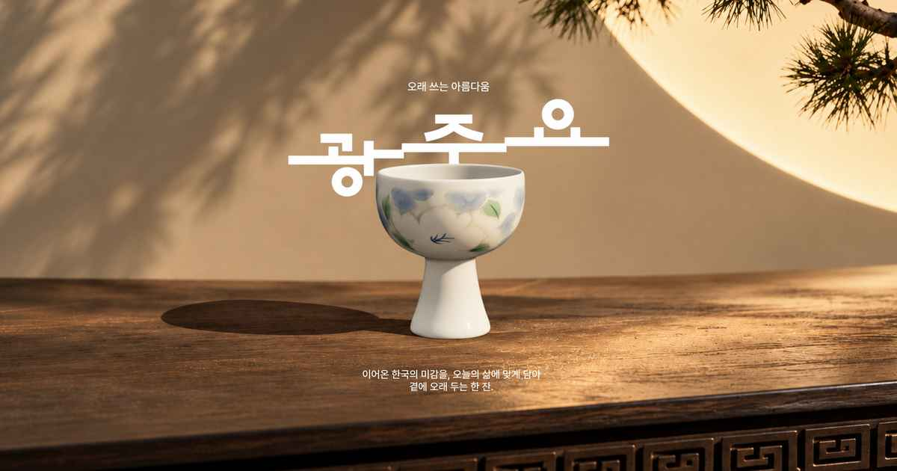

<!--
  타이틀 사진 자리
  - docs/readme/cover.jpg 파일을 원하는 사진으로 바꾸면 됩니다(같은 이름으로 덮어쓰기).
  - 권장 크기: 가로 2400 × 세로 1260px(2:1 안팎), JPG 또는 WebP
  - 지금은 공유 이미지(img/og-image.jpg)를 임시로 넣어 두었습니다.
-->
<p align="center">
  
</p>

<h1 align="center">광주요 리뉴얼</h1>

<p align="center">
  오래된 아름다움이 오늘의 쓰임이 되기까지.<br>
  소리잔 하나가 흙에서 불을 지나 오늘의 식탁에 놓이기까지를 따라가는 인터랙티브 브랜드 웹사이트
</p>

<p align="center">
  <a href="https://gwangjuyorenewal.vercel.app"><strong>사이트 보기 →</strong></a>
</p>

<br>

## 프로젝트 소개

한국 도자기 브랜드 **광주요**의 웹사이트를 새롭게 풀어 본 **UX/UI 포트폴리오 프로젝트**입니다.
상품을 나열하는 쇼핑몰 대신, 소리잔 하나의 일생을 스크롤로 따라가며 브랜드가 지켜 온 시간과 손, 불, 쓰임을 직접 체험하도록 설계했습니다.

| | |
|---|---|
| 성격 | 비공식 브랜드 리뉴얼 콘셉트(개인 포트폴리오) |
| 역할 | 기획 · UX/UI 디자인 · 인터랙션 · 프런트엔드 개발 |
| 언어 | 한국어 전용(전통 브랜드의 결을 살리기 위해 영문을 쓰지 않음) |
| 대응 | 데스크톱 · 태블릿 · 모바일 반응형 |
| 서체 | Pretendard(사이트에 쓰는 글자만 담은 경량 서체) |

<br>

## 이야기 흐름

스크롤 한 번이 이야기 한 장면입니다. 소리잔은 처음부터 끝까지 **하나의 3D 모델**로 이어집니다.

| 순서 | 장면 | 무엇을 경험하나요 |
|:---:|---|---|
| 1 | **처음** — 아름다움이 일상의 쓰임이 되도록 | 달빛과 소나무 그림자가 드리운 원목 탁자 위의 소리잔. 마우스를 따라 잔과 풍경이 살짝 움직입니다. |
| 2 | **되감기** — 작은 소리는 어디에서 시작될까요? | 잔이 거꾸로 돌며 처음으로 되돌아갑니다. |
| 3 | **물레** | 잔에 금이 가고 조각나 흙으로 돌아가, 물레 위에서 다시 빚어집니다. |
| 4 | **가마** — 이천 수광리 오름가마 | 불길 속에서 초벌 잔이 유약 잔으로 구워지고, 가마가 사라지면 잔이 떠올라 소나무 상자에 담깁니다. |
| 5 | **일상의 자리마다** | 상자가 열리고 무늬가 입혀진 잔이 여러 풍경 속에 놓입니다. 마지막 화보에서 3D 공간으로 들어가 잔 속 구슬 소리를 직접 굴려 들을 수 있습니다. |
| 6 | **쓰임으로 이어지는 아름다움** | 구슬이 굴러가는 자리를 따라 100% 수공업 · 공정 · 제작 · 위치 · 쓰임의 글자가 드러납니다. |
| 7 | **사람들의 이야기 · 리뷰** | 한 잔을 곁에 둔 사람들의 장면과 후기 |
| 8 | **풍경 갤러리** | 가로로 흐르는 화보. 사진보다 조금 느리게 따라오는 큰 제목 |
| 9 | **마무리** — 오래된 아름다움이 오늘의 일상으로 | 광주요 공식 온라인몰 · SNS로 이어지는 푸터 |

<br>

## 주요 인터랙션

- **하나로 이어지는 소리잔** — 로딩 화면부터 히어로, 깨짐, 가마, 상자까지 같은 3D 모델이 자리와 모습만 바꿔 이어집니다. 가마 속 잔도 3D 잔을 그대로 옮겨 그려, 장면이 바뀔 때 잔이 겹쳐 보이지 않습니다.
- **깨지고 다시 빚어지는 잔** — 미리 계산한 조각으로 잔이 금 가고 흩어져 흙더미가 됩니다.
- **오름가마의 불** — 셰이더로 그린 불길과 불티, 열기에 따라 달라지는 잔의 빛. 굽기가 끝나면 남은 빛만 선반에 고입니다.
- **덤블링 → 소나무 상자** — 잔이 한 바퀴 돌며 떠올랐다가 뚜껑이 열린 상자 안으로 내려앉고, 상자에서 나올 때 무늬가 입혀집니다.
- **구슬 소리** — 소리잔 굽 속 구슬을 마우스로 굴리면 벽에 부딪히는 세기에 따라 맑은 소리가 납니다(Web Audio로 실시간 합성).
- **부드러운 스크롤** — 휠 입력을 부드럽게 이어 모든 장면이 스크롤 위치에 맞춰 자연스럽게 움직입니다. 움직임 줄이기 설정을 켠 사용자에게는 정지 화면으로 보여 줍니다.

<br>

## 기술

| 분야 | 사용 |
|---|---|
| 3D | Three.js(r180), React Three Fiber 번들(히어로 장면), GLB 모델 |
| 그래픽 | GLSL 셰이더(가마 불길 · 열기 · 배경), 2D Canvas |
| 소리 | Web Audio API(구슬 충돌음 · 구르는 소리 · 잔향 실시간 합성) |
| 화면 | HTML · CSS(컨테이너 쿼리 · 클립 패스 · 스크롤 연동 CSS 변수) · 바닐라 JavaScript(ES 모듈) |
| 배포 | GitHub → Vercel 자동 배포 |

### 성능을 위해 한 일

- **WebGL 렌더러 공유** — 장면마다 따로 쓰던 WebGL 컨텍스트 12개를 공용 렌더러로 모아 5개로 줄였습니다.
- **로딩 기준** — 히어로 3D가 실제로 그려지고 네트워크가 잠잠해진 뒤, 프레임이 고르게 나올 때 로딩 화면을 엽니다(첫 화면 버벅임 방지).
- **해상도 자동 조절** — 기기 성능에 맞춰 3D 해상도를 조절하되, 화면 픽셀 밀도 아래로는 내리지 않아 외곽이 계단처럼 보이지 않습니다.
- **보이는 것만 그리기** — 화면 밖 장면은 그리지 않습니다.
- **가벼운 자원** — 이미지 WebP 변환, 모델 텍스처 WebP, 사이트에 쓰는 글자만 담은 서체(약 170KB).

<br>

## 폴더 구조

```text
├─ index.html          한 페이지 사이트
├─ css/                장면별 스타일(style · make · after-sound · footer · loader …)
├─ js/                 장면별 모듈
│  ├─ hero-scene.js    히어로 3D(소리잔 · 소나무 상자)
│  ├─ herobreak.js     잔 깨짐, breakwheel.js 조각 · 물레
│  ├─ clay.js          물레 장면, fire.js 오름가마
│  ├─ sound3d.js       3D 공간 · 구슬 소리
│  ├─ shared-gl.js     공용 WebGL 렌더러
│  ├─ loader.js        로딩 화면, smooth-scroll.js 부드러운 스크롤
│  └─ …
├─ assets/             3D 모델(GLB) · 텍스처
├─ img/                이미지(WebP)
├─ fonts/              Pretendard 경량 서체
├─ tools/              자원 생성 스크립트(배포 제외)
└─ docs/readme/        README 이미지(배포 제외)
```

<br>

## 로컬에서 보기

빌드 과정 없는 정적 사이트입니다. 폴더에서 아무 정적 서버나 띄우면 됩니다.

```bash
python3 -m http.server 8000
# http://localhost:8000
```

- 주소 뒤에 `?noloader`를 붙이면 로딩 화면 없이 바로 시작합니다.
- Three.js는 CDN(jsDelivr)에서 불러오므로 인터넷 연결이 필요합니다.

<br>

## 배포

`main` 브랜치에 올리면 Vercel이 자동으로 배포합니다. → <https://gwangjuyorenewal.vercel.app>

<br>

## 안내

- 이 사이트는 **개인 포트폴리오용 비공식 리뉴얼 콘셉트**이며 광주요와 공식적인 관계가 없습니다.
- 광주요 로고 · 제품명 · 제품 이미지의 권리는 광주요에 있습니다.
- 서체: [Pretendard](https://github.com/orioncactus/pretendard) (SIL Open Font License 1.1)
